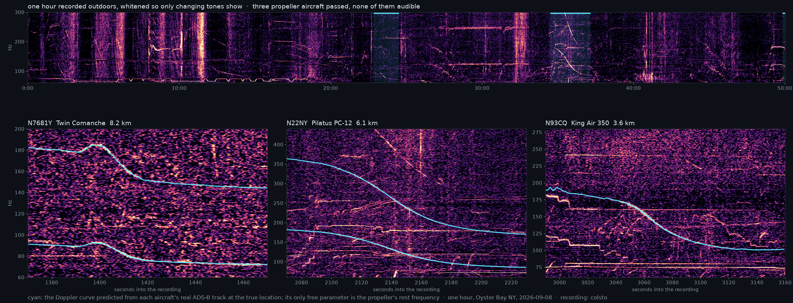

# dopplertrack



Acoustic geolocation from the Doppler curves of propeller aircraft.

> **This is a fork** of [mjshiggins/dopplertrack](https://github.com/mjshiggins/dopplertrack)
> by MacCallister Higgins, which reimplements the method shown in colsto's
> video ["I discovered a sound that leaks your exact location"](https://www.youtube.com/watch?v=UytYrhYLOKI).
> The physics, the pair join, the gates, the curve model and the verdict are
> upstream's. This fork adds a compact flight store (9.6× smaller than
> upstream's day index), an exact closest approach on curved tracks, and a
> two-stage search with a 50 m refinement. On a busy laptop a nationwide
> search of one day took 1-2 minutes (up to 4.5 minutes when the silence
> filter has a long stretch between events to check). Upstream took 5
> minutes on the eagle-cam day and 34 minutes, swapping, on the Oyster Bay
> day, on the same machine. There is no compatibility layer:
> `dopplertrack store` converts an upstream day index once.

Any outdoor (and many indoor) recordings contain faint, usually inaudible
tones from aircraft flying over: the propeller blade-pass fundamental and its
harmonics, between roughly 60 and 400 Hz. As the aircraft passes, the tone
sweeps down in frequency. The exact shape of that sweep depends on where the
listener was relative to the aircraft's real trajectory. With historical
ADS-B data for every flight that day, each candidate location on the ground
predicts a different curve, and the recording picks out the one that matches.

No code was released with the video. Upstream made the method open and
automatic and extended the search from a hand-drawn box to a whole
continent. This fork makes that search cheap enough to run on a laptop.
Read [Responsible use](#responsible-use) before using it.

## Status

| | Oyster Bay | eagle cam | railcam | McMaster Forest | Safari Road |
|---|---|---|---|---|---|
| role | development | development | development | held out | held out |
| recording | 1 h, 2026-09-08 | 12 h, 2024-12-28 | 11.9 h, 2026-05-28 | 12 h, 2026-05-27 | 7 h, 2023-07-09 |
| propeller flights that day (24-50° N, 66-125° W) | 35,427 | 13,046 | 29,420 | 25,892 | 15,613 |
| rank of the true pair, two events | **1** of 499 | 15 of 500 | 4 of 500 | 2 of 500 ¹ | not found |
| rank with extra flyovers | 1 | **1** of 200 | — | **1** of 200 ¹ | not found |
| best point from the answer | 26 m | 741 m | 95 m | 0.71 km ² | winner 1,715 km off |
| verdict (p) | located (0.06; 0.04 with the extra) | ambiguous (0.43) with extras | ambiguous (0.31), wrong pair | located (0.0005) with extras ¹ | no match |
| search time, M3 Pro, 11 workers ³ | 82 s | 56 s | 73 s | 89 s ¹ | 152 s ¹ |

¹ With the silence filter off (`--no-silence`), a setting chosen after the
pre-registered run, with the filter on, missed. See [docs/heldout.md](docs/heldout.md).
² From a reference point in the preserve; the recorder's position is not known.
³ Wall time after the track store exists, on a machine other jobs kept
busy (load average 7-16 at the start of the three development searches,
63-68 at the start of the two held-out ones), so upper bounds. Details
under [Performance](#performance).

The railcam is a negative result upstream already reported: the true pair
fits well but a smoother wrong track fits better. The eagle cam needs its
extra flyovers. Of the two held-out recordings, one was located, on a second
run with a changed setting, and one was not.

Two flyovers locate a recording when at least one passed low and to the
side. Two high, nearly overhead passes leave a plateau a few kilometres wide
and a continent full of pairs that fit, which is what the extra flyovers are
for. A margin is not a confidence: a search whose answer is not among the
flights still returns a winner. So every search ends with a verdict: the
winner is judged against the wrong pairs the same search scored, and p is
the chance a wrong winner would lead the next wrong pair by that much.
Upstream found false "located" calls (2 of 20 searches of the railcam with no
right answer), and the two-stage search scores only a shortlist, so p is a
guide, not a calibrated probability. Treat p < 0.1 as a weak claim.

The upstream experiments behind these methods are in
[docs/experiments.md](docs/experiments.md). This fork's measurements are in
[docs/fast-search.md](docs/fast-search.md), the held-out tests in
[docs/heldout.md](docs/heldout.md), and the configs to rerun them in
[benchmarks/](benchmarks/).

## Install

```bash
git clone https://github.com/andrew-medrano/dopplertrack && cd dopplertrack
uv sync
```

Python 3.12 or newer. `spectrogram` needs ffmpeg on the PATH for anything
libsndfile cannot read (mp3, m4a, video).

## Worked example: Oyster Bay

colsto's raw one-hour clip ([youtu.be/4CxVxuMVkMc](https://youtu.be/4CxVxuMVkMc)),
recorded on 2026-09-08. Only the date is given; the location and the start
time come out of the search.

```bash
# 1. Audio to a whitened 40-450 Hz spectrogram.
uv run dopplertrack spectrogram oyster_bay.wav rec.npz

# 2. Measure two flyovers, and a faint third one as an extra.
uv run dopplertrack fit rec.npz --window 2090 2200 --band 95 200 --harmonics 2 --out ev1.json
uv run dopplertrack fit rec.npz --window 3020 3130 --band 95 195 --out ev2.json
uv run dopplertrack fit rec.npz --window 1375 1465 --band 70 105 --harmonics 2 --out ev3.json
#    (or find them: uv run dopplertrack detect rec.npz --band 60 300 --top 10 --out detected.json)

# 3. One UTC day of propeller flights over the continental US, as a track store.
uv run dopplertrack fetch 2026-09-08 day --bbox 24 50 -125 -66

# 4. Search the whole store, rescore the best pairs with the extra flyover.
export OBJC_DISABLE_INITIALIZE_FORK_SAFETY=YES     # macOS only, see below
uv run dopplertrack search rec.npz --events ev1.json ev2.json --day day --harmonics 2 1 \
    --extra ev3.json --extra-harmonics 2 --workers 11 --out results.csv

# 5. Optional: a 50 m grid around the winner, and the verdict again.
uv run dopplertrack refine rec.npz results.csv --events ev1.json ev2.json --day day \
    --harmonics 2 1 --extra ev3.json --extra-harmonics 2 --out fine.csv
uv run dopplertrack verdict results_extra.csv
```

`search` prints the time of each stage, the best pair per flight pair and
the verdict. On this recording the winner is the PC-12 and King Air 350 pair
from the video, its best point 26 m from the answer, 8.1 % ahead of the runner-up; the
verdict is "located" (p = 0.06, and 0.04 with the extra flyover). `refine`
puts the peak with the extra flyover 96 m from the answer.
`results.csv` holds every scored candidate; `results_extra.csv` the best
pairs rescored with the extra flyover.

## Commands

- `spectrogram` decodes any audio or video with ffmpeg and whitens a
  high-resolution STFT of the 40-450 Hz band per frequency bin, so only
  changing tones stand out.
- `detect` finds the flyovers: an ideal straight-pass Doppler curve (f0,
  speed, CPA distance, CPA time) is grid-searched in a sliding window, and
  the local maxima are refined and ranked. Its `burst` column flags events
  that arrive with a broadband rumble (a passing train, say); `--max-burst`
  drops them. `fit` does the same in one window you choose. Either writes
  event JSON that `search` takes as it is.
- `fetch DATE DIR` streams one day of [adsb.lol](https://github.com/adsblol)
  history from GitHub (about 4 GB, nothing stored), drops known jets, and
  writes a track store. `--bbox` limits it to a region, `--archive DIR` reads
  an archive already on disk.
- `store DAY.npz DIR` converts a 1 Hz day index written by upstream 0.3's
  `fetch` into a track store, reading it through memory maps.
- `search` ranks (location, flight pair) candidates over a store.
  - `--bbox` restricts it to a region.
  - `--point LAT LON` scores one known location, the quickest check on a
    recording whose answer you know.
  - One event with `--utc TIME` searches a single flyover whose time is known.
  - `--extra` rescores the best `--top-pairs` pairs (200) with further
    flyovers, all on one clock.
  - `--cands` caches the candidate table, so a change to the scorer reruns
    only the scoring.
  - `--score ridge` scores how closely a curve follows the ridge traced in the
    window instead of the brightness under it (for faint curves).
  - `--no-silence` turns off the silence filter (for long recordings, below).
  - `--exact-pairs`, `--exact-points`, `--refine-pairs` size the second stage.
- `refine` lays a 50 m grid around one result, optionally with more events.
- `verdict CSV` judges the winner of a results CSV again.

The heavy stages run in a process pool. `--workers` sets its size. The
default is every core on Linux and 1 on macOS, where forking a process that
has used Objective-C or BLAS threads is unsafe by default. On macOS, export
`OBJC_DISABLE_INITIALIZE_FORK_SAFETY=YES` before passing `--workers`.

## How the fast search works

1. **Track store.** Every airborne stretch of every flight is kept as knots
   every 15 s: time, position and velocity in one Earth-centred frame,
   float32. Between knots the track is the cubic Hermite curve through them.
   Positions and velocities come from a 31 s quadratic least-squares fit of
   the 1 Hz track, so range rates are not differenced from noisy positions.
   A 10 s light index (one sample per flight per bucket) serves the join and
   the silence filter. The arrays are memory-mapped `.npy` files, so a store
   opens in under a second and costs no RAM until read. `meta.json` carries a
   format version; a store of another version is refused with the command
   that rebuilds it.
2. **Join.** Two events heard Δt apart at fitted slant distances d1 and d2
   mean the two aircraft were within d1 + d2 of each other, Δt apart in
   emission time (give or take the propagation delays). That is a KD-tree
   join over the light index, speed-gated, and it leaves tens of thousands of
   flight pairs out of hundreds of millions.
3. **Lens.** For each pair, ground points are laid only where both flights
   could have been heard: a 1 km lattice first, then 200 m where it passes.
   Every point gets the exact closest point of approach to each stored
   trajectory: slant distance (with a DEM for the observer's elevation),
   speed, and the *heard* CPA time. The closest approach is found on the
   Hermite curve itself: the nearest chord, then Newton steps on the arc of
   every chord that could still be closer, so a turning or circling track
   that comes back near a point is not missed. Points must hear an
   event-1-like pass, then Δt later an event-2-like pass, with no other
   propeller flight within 6 km in between (the silence filter).
4. **Tables.** Over the seconds that shape a Doppler curve most flights fly
   nearly straight. So each event gets a table of straight-pass scores over
   CPA distance × speed × time shift, built once, and every candidate gets a
   table lookup.
5. **Exact score.** The best 20 candidates of each of the best 500 pairs by
   table score (about 1 % of candidates) are scored on their real
   trajectories: the curve each would hear is modelled from the stored track
   (emission-time radial velocity) and scored against the spectrogram.
   Event 1's placement is swept over small time shifts and f0 scales, which
   absorb measurement error; event 2 is placed with the same shift, locked to
   the flight geometry. The scorer works on a log-frequency axis (0.1 %
   steps) with the harmonics summed once, so an f0 scale is an index offset
   and each placement is one integer gather.
6. **Refine.** Around the best point of each of the best 50 pairs, a 50 m
   lattice (±300 m) is gated the same way and scored exactly. A sharp peak
   can sit between two points of the 200 m lattice: on Oyster Bay a point
   190 m off scores 24 against 29 at the peak.
7. **More events.** For the best pairs, each further flyover is matched to a
   flight at the pair's best point and scored at all of its points with that
   point's shift, so every event is on one clock.
8. **Verdict.** At most one scored pair is right; the rest are the null for
   this recording. The upper tail of their scores is fitted as exponential,
   and the winner's lead over the best other pair is tested against it:
   located (p < 0.1), ambiguous (p < 0.5), or no match.

With `--point`, or whenever no more than `--exact-pairs` pairs and
`--exact-points` candidates per pair survive, every candidate is scored
exactly and the tables are skipped. The ideal-curve fits only seed the gates
(`--v-tol`, `--d-tol`; open them for a faint or turning pass); ranking uses
real trajectories throughout.

On long recordings the silence filter can veto the right answer: between
two events hours apart, another propeller flight almost always passed within
6 km. Upstream turned it off for its 12-hour railcam; the McMaster hit in
[docs/heldout.md](docs/heldout.md) needed it off.

## Performance

All numbers are from an Apple M3 Pro (12 cores, 18 GB RAM) with 11 worker
processes, on 2026-11-06. The machine was **not idle**: other jobs kept the
load average between 19 and 60, so wall times are upper bounds and CPU time
is the steadier comparison. Full tables, and how each was measured, are in
[docs/fast-search.md](docs/fast-search.md).

**Storage.** A search needs the knots and the light index, so both are
counted.

| day | upstream 1 Hz index | track store | ratio |
|---|---|---|---|
| Oyster Bay | 6.21 GB | 646 MB (288 MB knots + 358 MB light index) | 9.6× |
| eagle cam | 1.93 GB | 201 MB | 9.6× |
| railcam | 5.54 GB | 577 MB | 9.6× |
| McMaster Forest | 4.69 GB | 488 MB | 9.6× |
| Safari Road | 1.93 GB | 202 MB | 9.6× |

The knots alone are 21-22× smaller. Upstream reads its index into RAM; the
store is memory-mapped and opens in 0.2-2.4 s. The main search process
peaked at 1.4-2.4 GB.

**Search time, this fork against upstream 0.3, same machine, run one after
the other:**

| | upstream 0.3 | this fork | ratio |
|---|---|---|---|
| eagle cam, wall / CPU time | 309 s / 2,654 s | 58 s / 458 s | 5.4× / 5.8× |
| eagle cam, peak memory | 3.6 GB | 1.4 GB | |
| Oyster Bay, wall / CPU time | 2,043 s / 12,086 s | 88 s / 664 s | 23× / 18× |
| Oyster Bay, peak memory | 8.5 GB | 1.7 GB | |

Upstream's Oyster Bay run swapped (its 6.2 GB index on an 18 GB machine)
and shared the machine with the test suite for 7 of its 34 minutes, so its
ratio overstates what a machine with spare RAM would see; the eagle cam's
5-6× is the fairer figure. Both searches found the same winners.

The five recordings took 56-152 s each with the default settings or with
the silence filter off. With the filter on, the two held-out recordings,
whose events are 47 minutes and 5.3 hours apart, took 159-267 s (measured
before the 0.25 s shift grid, which adds about 2 s). The lens stage
(lattices, exact closest approaches, gates, silence filter) is 77-92 % of
the time; the scoring that dominated upstream takes 7-10 s.

**Against the research prototype, back to back.** The prototype that came
before this port scored with chords instead of the curve (nearest knot,
then the two chords beside it) and dropped valid candidates in its
pre-gate. Each pair of runs below was started one right after the other,
same machine, same events, 11 workers, at load averages of 7-22:

| | prototype | this fork | fork / prototype |
|---|---|---|---|
| Oyster Bay: search stages / lens / CPU time | 60 s / 44 s / 496 s | 80 s / 64 s / 637 s | 1.34 / 1.44 / 1.28 |
| eagle cam: search stages / lens / CPU time | 35 s / 24 s / 335 s | 53 s / 42 s / 462 s | 1.52 / 1.74 / 1.38 |
| railcam: search stages / lens / CPU time | 45 s / 29 s / 359 s | 70 s / 54 s / 571 s | 1.58 / 1.87 / 1.59 |
| peak memory, main process | 1.9-2.8 GB | 1.4-2.1 GB | |
| store on disk, light index included | 1.25-1.46 GB (0.53 GB eagle cam) | 0.58-0.65 GB (0.20 GB eagle cam) | 0.38-0.46 |

The prototype's times leave out a second exact stage it ran and threw away
(6-7 s). The fork's lens is 1.4-1.9× slower: its closest approaches are
exact on the curve, which costs about three times the chord step. These
fork runs are from the commit before the last lens change (a chord-distance
prefilter, same candidates, 7-17 % less lens CPU on 4,000-pair samples). A
second pairing with the final code, at load averages of 42-70, gave
1.5-2.2× for the lens and 1.2-1.6× for CPU time, the same results, and
wall times 1.5-1.6 times those above. The fork's ranks are within two places
of the prototype's (table under Status; the prototype had the eagle cam's
true pair 13th and the railcam's 3rd).

**Earlier figures.** A research write-up before this port gave "10-26×
faster". That compared the prototype with upstream's scorer timed on a
4,000-row sample and **extrapolated**, on a laptop that was swapping. Against
a measured full log-axis search the prototype was 5.8-7× faster. On the
held-out recordings the prototype took 53-131 s per day. A year of days
would be 365 searches, about 6-15 hours at 1-2.5 minutes each (more where
the silence filter is slow), with the stores already built (streaming one
day's archive took 1-5 minutes here). Nothing year-long was run, and
per-day p-values are not corrected for 365 searches.

**What the speed costs.** Only about 1 % of candidates are scored exactly,
and the verdict's null is the shortlist. On the eagle cam with its extras,
upstream finds the same winner with a 13.5 % margin and "located"
(p = 0.05); this fork gives 4.9 % and "ambiguous" (p = 0.43). On Oyster Bay
with its extra flyover, upstream leads by 24.3 % (p = 0.0001) and this fork
by 12.4 % (p = 0.04). Only the best 50 pairs are refined, so a true pair
just below that line can lose to its own sharp peak: on the railcam, with
0.5 s time-shift steps, the true pair ranked 53rd after the exact stage
and stayed 53rd; with the 0.25 s steps now used it is 33rd, gets refined,
and ranks 4th.

## Differences from the method in the video

The physics and the search strategy are the video author's. What upstream
changed, and this fork keeps:

- **Automatic curve measurement.** The video slides f0, speed, distance and
  CPA time by hand until the overlay looks right. `fit` and `detect` do it
  with a grid search plus Nelder-Mead on the whitened window.
- **Pairs of flights, not points along one flight.** The video lays points
  along every flight matching event 1 at the fitted distance and tests them
  for event 2, which needs tight hand-fitted ranges. Joining flight pairs on
  the geometry of both events first stays cheap under the wide gates an
  automatic fit needs; with tight gates it reduces to the video's method.
- **Harmonic-aware fitting and scoring**, where a flyover shows a second
  harmonic.
- **Open data path.** adsb.lol daily archives, ICAO Doc 8643 engine classes
  and AWS terrain tiles, each with a loader; nothing scraped or paid.
- **One command for every search.** A box, a known point, or one flyover
  with a known time are options on the same search.

Kept on purpose: emission-time radial velocity, propagation-delayed CPA
times, slant distance with a DEM, the inter-event offset filter, the silence
filter, and locked two-event scoring.

## Responsible use

This is a dual-use tool. It lowers the cost of finding where a recording was
made: a dated outdoor recording with two or more propeller flyovers can be
checked against every propeller flight over the continental US in a couple
of minutes on a laptop, and a year of dates is roughly 6-15 hours of
searching. That
puts people who post audio or video (a backyard stream, a field recording,
a voice memo by an open window) within reach of anyone who wants to find
them.

Do not use it to locate people who have not agreed to it. It exists to show
how much a recording leaks, to test defences, and to verify the provenance
of public recordings.

Its limits, which protect no one reliably: it needs at least two flyovers
the spectrogram shows, ADS-B coverage of those flights, and the UTC date or a
search over many dates. It is wrong often. Of the two recordings it had not
seen, it located one, and only on a second run with a changed setting. Over
many dates the per-day p-values are not corrected for the number of
searches, so confident wrong answers become likely.

If you publish recordings and want to make this harder:

- **Remove the band it uses.** A high-pass filter above about 450 Hz removes
  the propeller fundamentals and low harmonics this search reads (it also
  thins voices and music). Higher harmonics can survive in loud passes; this
  has not been tested against an attacker who looks for them.
- **Withhold the date and time**, and strip them from file metadata. This
  only raises the cost: one search per candidate day.
- **Publish short clips.** Fewer flyovers mean fewer constraints, but one
  flyover with a known time still placed Oyster Bay within 2 km in a box.
- **Add decoys.** [chaff](https://github.com/andrew-medrano/chaff) adds
  synthetic propeller flyovers so a search finds too many plausible curves.
  In its own tests it made the search unreliable rather than defeating it: on
  Oyster Bay the true pair was still, narrowly, the most confident answer,
  and its louder decoys are audible. Its README lists what was measured and
  what was not.

None of these touch other side channels (mains hum, voices, landmarks).

## Data and licences

| need | source | licence |
|---|---|---|
| historical ADS-B | adsb.lol `globe_history_YYYY` GitHub releases (about 4 GB a day) | [ODbL 1.0](https://opendatacommons.org/licenses/odbl/1-0/) |
| aircraft engine class | OpenSky mirror of ICAO Doc 8643 | as published by OpenSky |
| elevation | AWS Terrain Tiles (Terrarium) | per the [tile sources' attribution](https://github.com/tilezen/joerd/blob/master/docs/attribution.md) |

Flight data and track stores derived from adsb.lol are a database under
ODbL: if you share them, attribute adsb.lol and share them under the same
licence. Nothing derived from it is committed here beyond small result
tables. No recordings are redistributed. The benchmark configs link to the
public sources (YouTube, the Internet Archive), and the held-out recordings
carry no stated licence.

The code is MIT, as upstream: copyright MacCallister Higgins, with this
fork's changes by Andrew Medrano ([LICENSE](LICENSE)).

## Development

```bash
uv sync --dev
uv run pytest -q
```

The suite runs on synthetic flights in a few minutes. The Oyster Bay check
against the real recording is opt-in: set `DOPPLERTRACK_OYSTER_BAY` to a
directory holding `rec.npz` and `traces_ny.npz` (see
`tests/test_oyster_bay.py`). Upstream's design notes are in
`docs/superpowers/specs/`; [CHANGELOG.md](CHANGELOG.md) lists the changes
per release.

## Releasing

Pushing a tag `vX.Y.Z` that matches the version in `pyproject.toml` runs
`.github/workflows/release.yml`: tests, sdist and wheel, and a GitHub
Release with generated notes. The PyPI job from upstream is disabled on this
fork, since it would publish under upstream's package name.

```bash
uv version 0.4.1            # bump pyproject.toml
git commit -am "Release 0.4.1"
git tag v0.4.1 && git push && git push --tags
```
